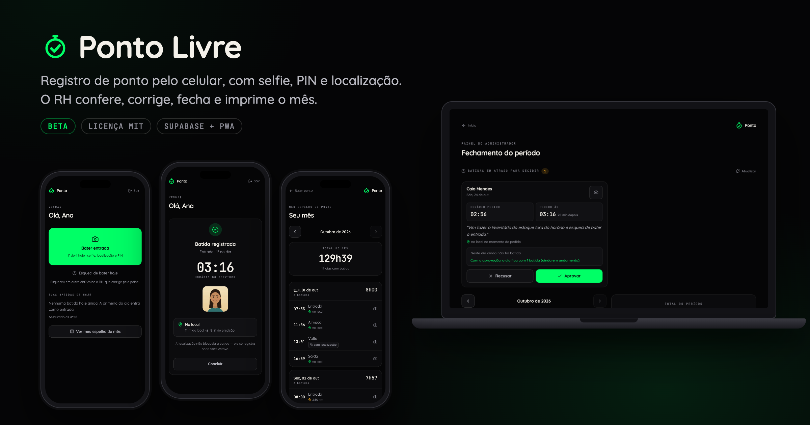
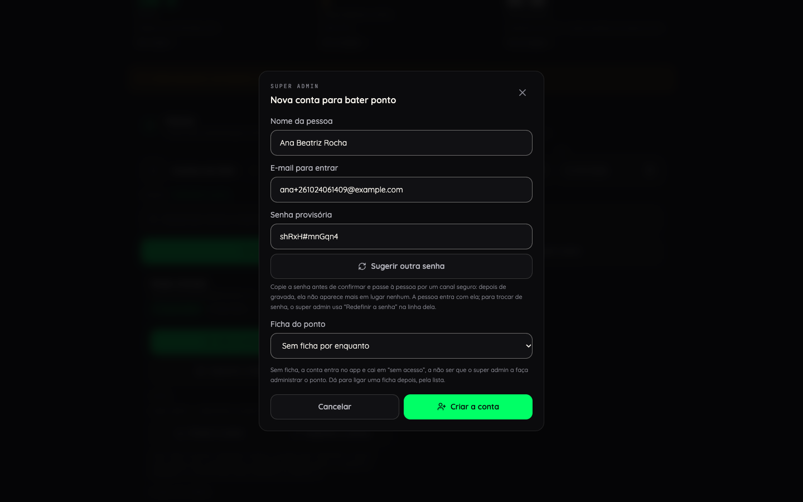
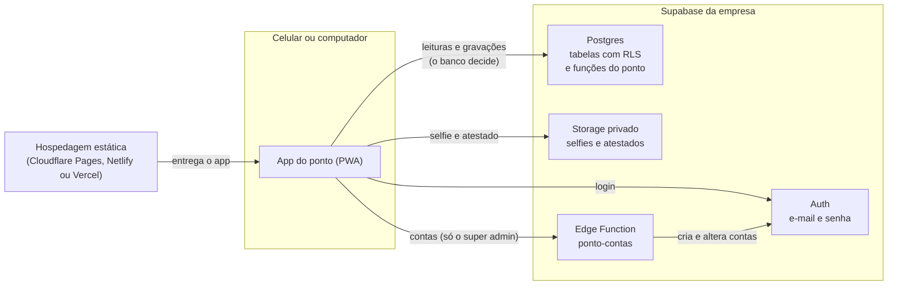

# Ponto Livre

Registro de ponto pelo celular, com selfie, PIN e localização. O RH confere, corrige, fecha e imprime o mês.

`versão 0.9.0-beta.1` · `licença MIT` · `beta`

> [!WARNING]
> **Beta.** Este projeto está em beta. Ele nasceu de um sistema em uso real numa empresa, mas ainda pode precisar de melhorias — veja [Limitações](#limitações-conhecidas-beta).



## Duas formas de usar

O ponto guarda as contas, as batidas e as fotos no [Supabase](https://supabase.com), um serviço de banco de dados, login e arquivos, com plano grátis. Quem cuida de tudo isso pode ser o autor ou você:

| | Na estrutura do autor | Na sua estrutura |
| --- | --- | --- |
| Quem cuida do servidor, do banco, das cópias de segurança e das atualizações | o autor | você |
| Tamanho | até 25 funcionários (acima de 20, leia o [aviso legal](#limitações-conhecidas-beta)) | sem limite do projeto (o limite é o do seu plano no Supabase) |
| Custo | R$ 150 por mês | o código é grátis (licença MIT); a hospedagem pode custar, conforme o tamanho |
| Como começar | um e-mail para wesley.sbl@gmail.com, se houver vaga | o guia [`docs/INSTALAR.md`](docs/INSTALAR.md) |
| Suporte | combinado por e-mail | nenhum: o código e a documentação estão aqui |

O Ponto Livre não é um produto à venda e não tem equipe de atendimento. Ele nasceu para uso próprio e foi aberto para quem quiser. A hospedagem na estrutura do autor existe para poucos, combinada por e-mail; para todo o resto, a documentação deste repositório é o caminho.

## Para quem serve

Para qualquer equipe que precisa saber quem chegou, quando e de onde, sem relógio de ponto na parede:

- **Pequenas empresas e escritórios.** Cada pessoa bate pelo próprio celular.
- **Lojas e franquias.** Uma instalação por empresa; numa rede, cada unidade pode ter a sua.
- **Clínicas e consultórios.**
- **Equipes que trabalham na rua.** A distância não bloqueia a batida: ela fica registrada e marca "no local" ou "fora do local".
- **Escolas**, para professores e funcionários.
- **Igrejas e ONGs** com equipe registrada.
- **Obras e serviços de campo**, onde a batida acontece longe do escritório.

O que ele **não** é:

- **Não é ponto eletrônico oficial (REP-P).** Serve como controle interno. Pela CLT (art. 74, § 2º), o estabelecimento com mais de 20 trabalhadores é obrigado a registrar o ponto: se for o caso da sua empresa, leia o [aviso legal](#limitações-conhecidas-beta) antes.
- **Não é controle de acesso.** Não abre porta nem catraca.
- **Não é biometria.** A selfie não é comparada com nada: ela é a prova de quem apertou o botão, e quem olha é uma pessoa.
- **Não é folha de pagamento.** Ele soma as horas trabalhadas; salário, férias e impostos ficam com a contabilidade.

## O que ele faz

### Quem bate ponto

- Entra uma vez com e-mail e senha. O celular guarda a sessão.
- Bate o ponto com selfie, localização e um PIN de 4 dígitos. O horário é o do servidor.
- Vê o comprovante na hora e confere o próprio mês no espelho.
- Esqueceu de bater? Pede a batida no mesmo dia, e ela entra quando o RH aprova.

<table>
  <tr>
    <td align="center" width="33%"><br><sub>Bater o ponto</sub></td>
    <td align="center" width="33%"><br><sub>O comprovante</sub></td>
    <td align="center" width="33%"><br><sub>O espelho do mês</sub></td>
  </tr>
</table>

### Quem administra (o RH)

- Vê o mês de todo mundo, com o total de horas e o que falta resolver antes de fechar.
- Corrige um horário ou insere a batida que faltou. Sempre com motivo, e a trilha guarda o valor anterior.
- Aprova ou recusa os pedidos de batida esquecida.
- Lança falta justificada, com a foto do atestado.
- Imprime a folha do mês para assinar e exporta tudo em CSV.

<table>
  <tr>
    <td align="center" width="33%"><br><sub>O fechamento do período</sub></td>
    <td align="center" width="33%"><br><sub>Os dias de uma pessoa</sub></td>
    <td align="center" width="33%"><br><sub>A folha para assinar</sub></td>
  </tr>
</table>

### O super admin

- Faz tudo o que o RH faz.
- Cria as contas, com senha provisória, e troca nome, e-mail e senha.
- Liga cada ficha de RH à conta certa e escolhe quem administra o ponto.

<table>
  <tr>
    <td align="center" width="33%"><br><sub>Pessoas: conta, ficha e PIN</sub></td>
    <td align="center" width="33%"><br><sub>Criar uma conta</sub></td>
    <td align="center" width="33%"><br><sub>A administração</sub></td>
  </tr>
</table>

O passo a passo de cada papel está no [manual](docs/MANUAL.md).

## Como funciona



- **Sem backend próprio.** O app é um site estático que se instala no celular como ícone (PWA). Ele fala direto com o Supabase: o login, o banco e os arquivos.
- **Quem recusa é o banco.** Toda tabela tem RLS (as regras do próprio banco que dizem quem lê e grava cada linha), e o que mais importa (horário do servidor, tipo e origem da batida, trilha de correção, PIN) mora em gatilhos e funções do Postgres. A tela não é a trava: quem administra e abre o próprio ponto no painel ainda vê **Corrigir** e **Inserir batida**, e é o banco que recusa (ninguém corrige o próprio ponto), com uma frase que o app traduz.
- **A batida de quem bate passa por uma função só**, `ponto_registrar_batida`: ela confere o PIN e a selfie recém-enviada e grava com o horário do servidor.
- **As contas passam pela Edge Function `ponto-contas`** (um pedaço de código que roda no servidor do Supabase), que só atende o super admin e grava uma trilha de cada ação, sem a senha.

Feito com React 19, TypeScript, Vite, Tailwind 4, react-router 7 e Supabase JS. Testes com Vitest e Playwright. O modelo de dados está em [`docs/BANCO.md`](docs/BANCO.md).

## Começar

| Quero... | Leia |
| --- | --- |
| Pôr o ponto no ar para uma empresa (Supabase na nuvem e hospedagem grátis) | [`docs/INSTALAR.md`](docs/INSTALAR.md) |
| Rodar na minha máquina, para testar ou mexer no código | [`docs/RODAR-LOCAL.md`](docs/RODAR-LOCAL.md) |
| Cadastrar o time, do zero à primeira batida | [`docs/CADASTRO.md`](docs/CADASTRO.md) |
| Usar no dia a dia (quem bate, o RH, o super admin) | [`docs/MANUAL.md`](docs/MANUAL.md) |
| Instalar o app no celular de cada pessoa | [`docs/INSTALAR-NO-CELULAR.md`](docs/INSTALAR-NO-CELULAR.md) |

Depois de instalar, crie o primeiro super admin com [`supabase/primeiro-super-admin.sql`](supabase/primeiro-super-admin.sql) (o passo 5 do guia de instalação). Sem ele, ninguém entra: para todo mundo, o app diz que o acesso não está liberado.

## Por que é assim

- **A distância não bloqueia.** A batida registra onde a pessoa estava e marca "no local" ou "fora do local".
- **A foto é evidência, não biometria.** Sem reconhecimento facial: ninguém é comparado com ninguém.
- **O horário é sempre o do servidor.** O relógio do celular se muda nas configurações.
- **O funcionário não escolhe o tipo da batida.** Entrada, almoço, volta e saída saem da ordem do dia.
- **Não existe fila offline.** Sem internet, a batida não acontece, e o app diz isso.
- **Batida não se apaga.** Corrigir exige motivo e deixa trilha com o valor anterior.

Cada decisão, com o porquê e o que se troca por ela: [`docs/DEFESA.md`](docs/DEFESA.md).

## Segurança

- As regras moram no banco: RLS em todas as tabelas, nenhum privilégio para quem não entrou e funções com caminho de busca fixo. É o banco que decide a origem da batida: a "do app" só nasce pela função da batida, com selfie e PIN, e ninguém lança nem corrige o próprio ponto.
- O PIN só existe como hash bcrypt. Cinco erros seguidos travam a conta, e a trava endurece no mesmo dia: 15 minutos no primeiro bloqueio, 1 hora no segundo, 24 horas do terceiro em diante. Selfies e atestados ficam em buckets privados, com links que expiram.
- O app roda sob uma política de conteúdo (CSP) gerada no build: o navegador só executa o JavaScript do próprio app e só conversa com o endereço dele e com o Supabase configurado. As fontes também saem do próprio app.
- Para avisar de uma falha, siga [`SECURITY.md`](SECURITY.md).

## Limitações conhecidas (beta)

- **Um Supabase por empresa.** Não é multiempresa.
- **Um local de trabalho por vez.** Quem bate em outra unidade aparece como "fora do local". A batida vale do mesmo jeito.
- **Fuso único:** `America/Sao_Paulo` (horário de Brasília). O dia de cada batida, a folha e as regras seguem esse fuso.
- **A pessoa não troca a própria senha pelo app.** O super admin redefine e passa uma senha provisória.
- **Redefinir a senha não derruba a sessão antiga na hora.** O aparelho que estava logado não renova mais a sessão, mas o token de acesso que ele já tinha continua aceito pelo banco até vencer: até 1 hora, no padrão do Supabase.
- **Testado no computador, não num celular de verdade.** O teste de ponta a ponta roda no Chrome, com câmera e GPS simulados, e o caminho inteiro sob a política de conteúdo também passou no WebKit, o motor do Safari, numa conferência à parte. Nenhum teste automático roda num iPhone ou num Android.
- **Sem fila offline**, de propósito: sem internet, a batida não acontece.
- **O JavaScript é um arquivo só**: cerca de 220 kB com gzip no build de produção, com as variáveis do Supabase definidas (sem elas, o build sai podado e bem menor). A primeira abertura numa rede lenta pode levar alguns segundos.
- **O painel conta o dia de hoje, ainda em andamento, como incompleto** (no total do período, no cartão e no resumo da pessoa). O espelho de quem bate e a lista "Antes de fechar" já tratam hoje como dia em andamento.
- **Sem saldo de horas.** A carga diária e a tolerância ficam guardadas na configuração, mas ainda não entram em conta nenhuma: não há banco de horas, hora extra, atraso calculado nem feriados. A folha soma as horas trabalhadas.
- **Aviso legal.** Pela CLT (art. 74, § 2º), o estabelecimento com mais de 20 trabalhadores é obrigado a registrar a hora de entrada e de saída, e o registro eletrônico segue a Portaria MTP nº 671/2021. O Ponto Livre não é um REP-P registrado nem gera os arquivos AFD e AEJ dessa portaria: ele serve como controle interno e prova de presença. Quem passa de 20 trabalhadores no estabelecimento deve confirmar com o contador ou o advogado se ele atende ao caso.

## Testes

```bash
npm test          # 1434 testes, 52 arquivos
npm run db:testar # as regras do banco, no Supabase local (precisa do Docker)
npm run e2e       # de ponta a ponta no Chrome, contra o Supabase local
```

O `npm test` roda sem rede e sem banco. Os outros dois precisam do Supabase local de pé: veja [`docs/RODAR-LOCAL.md`](docs/RODAR-LOCAL.md). O CI ([`.github/workflows/conferir.yml`](.github/workflows/conferir.yml)) roda em todo push a conferência das dependências que vão para o ar (`npm audit --omit=dev --audit-level=high`), o lint, os testes, a conferência da contagem acima (`node scripts/conferir-readme.mjs`), o build e os testes de banco. Para contribuir, veja [`CONTRIBUTING.md`](CONTRIBUTING.md); as mudanças de cada versão estão no [`CHANGELOG.md`](CHANGELOG.md).

## Licença e créditos

MIT. Veja [`LICENSE`](LICENSE).

As fontes Quicksand e JetBrains Mono estão sob a SIL Open Font License 1.1. Elas entram no build pelos pacotes `@fontsource` e são servidas pelo próprio app, sem chamar o Google Fonts.

Criado por Wesley Lourenço.
