# Do zero à primeira batida

[Voltar ao README](../README.md)

Este guia mostra o cadastro inteiro numa instalação nova, com um print por passo: o super admin abre o ponto, cria a conta e a ficha de uma pessoa que bate ponto, faz uma pessoa do RH administrar, e as duas usam o app.

Os prints são de verdade. Eles saem do teste automático de ponta a ponta (`PRINTS=1 npm run e2e`), com pessoas fictícias e com a câmera e o GPS simulados. O número no meio dos e-mails (como em `ana+261024061409@example.com`, o e-mail da Ana nos prints) é a marca de cada execução do teste. Na sua instalação, os e-mails são os do seu time.

| Quem | No exemplo |
| --- | --- |
| Sérgio Almeida | super admin: instalou o ponto |
| Ana Beatriz Rocha | bate ponto (cargo: Vendas) |
| Rita Moraes | RH: administra o ponto e não bate |
| Empresa Exemplo Ltda | a empresa |

Antes de começar, o primeiro super admin precisa existir. Ele nasce na instalação, por SQL: veja o [passo 5 do guia de instalação](INSTALAR.md#5-criar-o-primeiro-super-admin).

## Quatro coisas para entender antes

### Conta e ficha são coisas diferentes

| | Conta | Ficha |
| --- | --- | --- |
| O que é | o login: e-mail e senha | o cadastro de RH: nome completo, CPF, matrícula, cargo, admissão |
| Para que serve | entrar no app | dar o nome à pessoa em toda tela e na folha que ela assina (da ficha, só o nome completo vai para a folha) |
| Quem cria | o super admin | quem administra o ponto |
| Pode existir sozinha? | sim: quem só administra não tem ficha | sim: a ficha pode nascer antes da conta |

**Entra no ponto** quem tem uma ficha ativa ligada à conta, ou quem administra. **Bate ponto** quem tem ficha ativa ligada (e o super admin sem ficha ativa, só para teste). Ligar uma ficha a uma conta é o que libera o ponto para ela, e por isso é tarefa do super admin.

### A senha provisória

- O super admin escolhe a senha ao criar a conta, ou aceita a que o app sugere.
- A tela mostra a senha **uma vez**. Copie antes de confirmar e passe à pessoa por um canal seguro. Depois de gravada, ela não aparece em lugar nenhum.
- A pessoa entra com ela. O app não pede para trocar, e não tem tela para isso. Se a pessoa quiser outra senha, ou esquecer a dela, o super admin usa **Redefinir a senha** e passa uma nova provisória.

### Quem só administra

É o RH que fecha a folha e não bate ponto: tem conta, administra e não tem ficha. Depois de entrar, cai direto no painel. Se um dia precisar bater, o super admin liga uma ficha à conta.

### O super admin

- Nasce por SQL, na instalação. A lista de super admins não muda pelo app.
- Faz tudo o que quem administra faz, e mais: cria as contas, troca nome, e-mail e senha, liga as fichas e escolhe quem administra.
- Sem ficha ativa ligada à conta, pode bater ponto só para testar, e as batidas dele não entram na folha de ninguém do time. Com uma ficha ativa ligada, bate pela ficha, como qualquer pessoa.
- O e-mail de uma conta de super admin só muda pelo painel do Supabase.

## Parte 1. O super admin abre o ponto

### 1. Entrar

O super admin abre o endereço do app e entra com o e-mail e a senha criados no painel do Supabase.

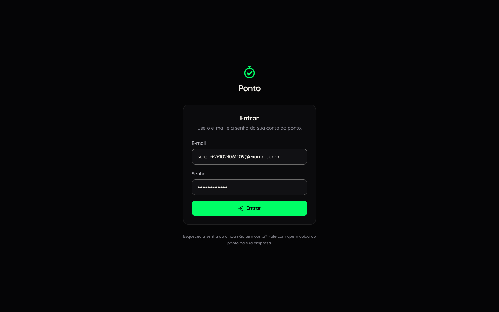

### 2. Criar o PIN

Na primeira entrada, o app pede um PIN de 4 dígitos (**Crie seu PIN**) e depois a repetição (**Repita o PIN**). Ele vai ser pedido a cada batida.

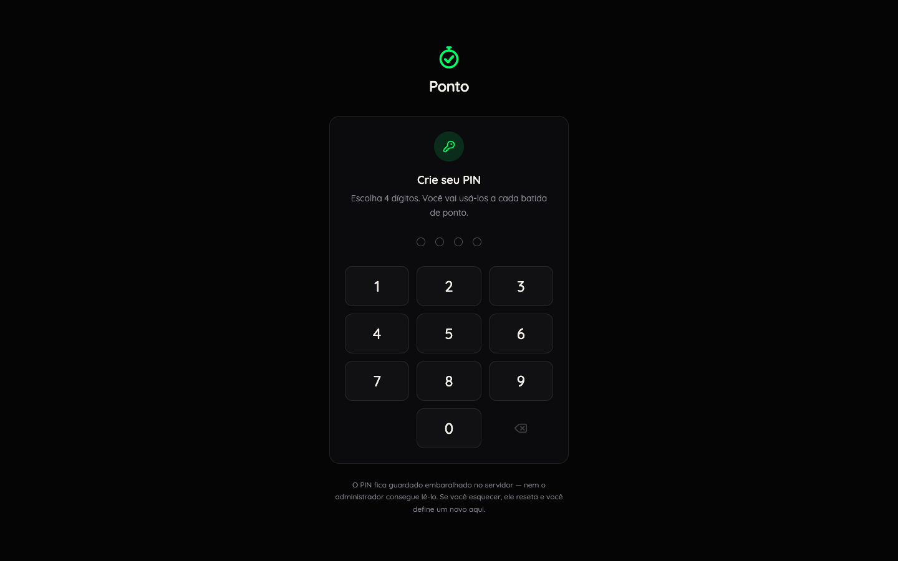

### 3. A tela inicial

O super admin vê o botão de bater (só para teste) e as portas da administração: **Corrigir ponto**, **Painel do administrador** e **Administração**. Ele toca em **Administração**.

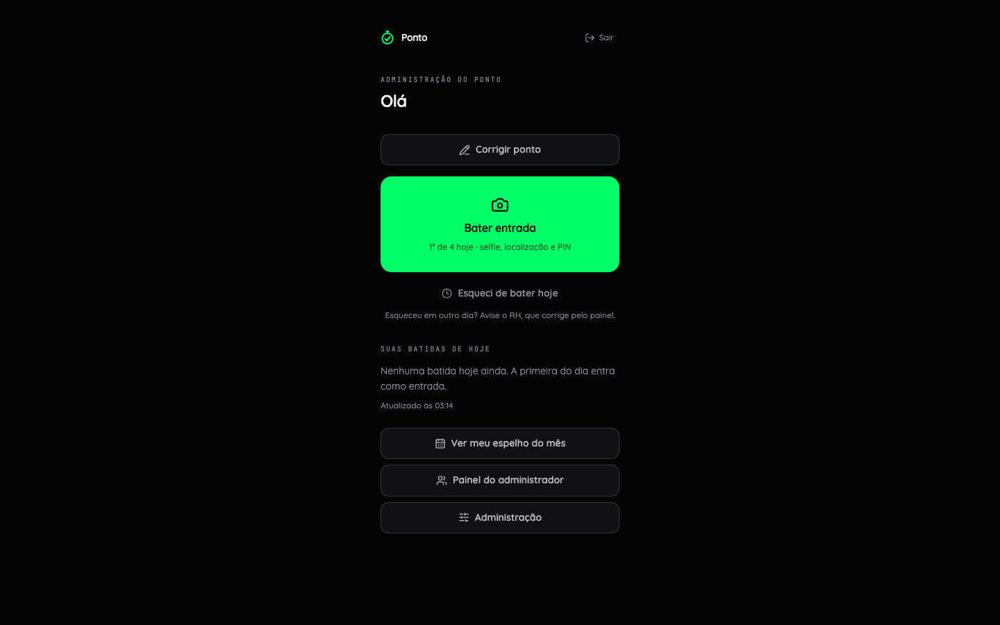

### 4. Pôr o próprio nome

A conta criada no painel do Supabase nasce sem nome. Na lista **Pessoas**, ele abre a própria linha, toca em **Trocar o nome**, escreve o nome e confirma em **Trocar o nome**.

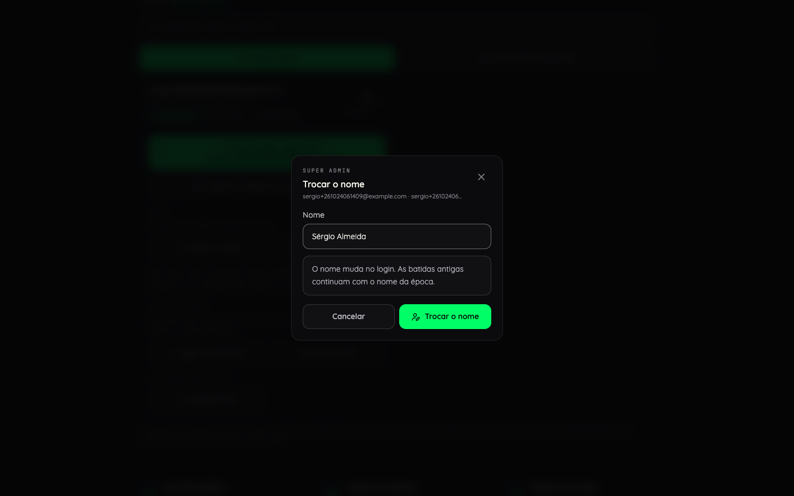

### 5. Local, empresa e jornada

Embaixo da lista de pessoas ficam três blocos, cada um com o seu botão de salvar:

- **Local de trabalho**: nome, latitude, longitude e raio. A batida dentro do raio sai "no local"; fora dele, "fora do local". A distância não bloqueia nada. O jeito mais certo de medir é pelo celular, de dentro do local, com **Usar a localização deste aparelho**.
- **Dados da empresa**: razão social, nome de fantasia, CNPJ, endereço, cidade e UF. É o cabeçalho da folha que a pessoa assina. Campo em branco imprime em branco.
- **Regras de jornada**: a carga diária, a tolerância e a janela que recusa batida repetida.

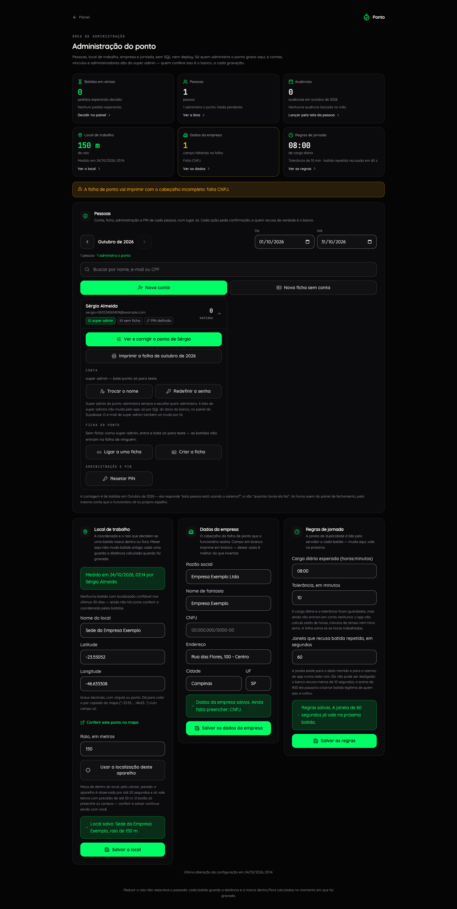

No exemplo, o CNPJ ficou em branco de propósito, e o app avisa: "A folha de ponto vai imprimir com o cabeçalho incompleto: falta CNPJ".

## Parte 2. A conta e a ficha da Ana

### 6. Criar a conta

**Nova conta** abre a caixa **Nova conta para bater ponto**:

- **Nome da pessoa** e **E-mail para entrar**;
- **Senha provisória**, já preenchida com uma sugestão (**Sugerir outra senha** troca por outra);
- **Ficha do ponto**, com três escolhas: uma ficha que já existe sem conta, **Criar uma ficha nova com este nome**, ou **Sem ficha por enquanto**.

Copie a senha e clique em **Criar a conta**.

O exemplo usa **Sem ficha por enquanto** para mostrar cada peça separada. No dia a dia, **Criar uma ficha nova com este nome** faz os passos 6, 7 e 8 de uma vez: a conta nasce com uma ficha só com o nome, já ligada, e o resto da ficha se completa depois em **Editar a ficha**.

### 7. Criar a ficha de RH

**Nova ficha sem conta** abre a ficha do **Funcionário do ponto**: nome completo, CPF, matrícula, cargo, admissão, desligamento, CTPS e série, centro de custo e **Passou a bater ponto aqui em**. Da ficha, só o nome completo sai na folha que a pessoa assina; o resto fica guardado no cadastro. Clique em **Criar a ficha**.

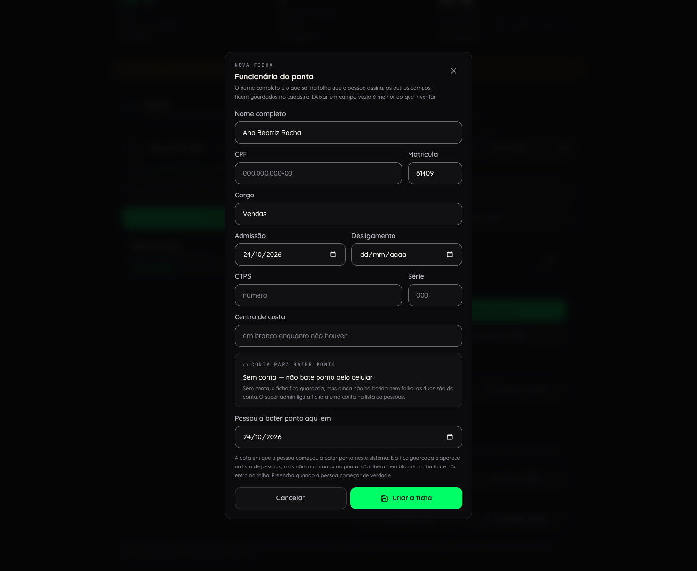

- Deixe em branco o que você não tem: campo vazio é melhor do que inventar.
- **Passou a bater ponto aqui em** é a data em que a pessoa começou a bater ponto neste sistema. Preencha quando ela começar de verdade. Hoje o app guarda e mostra essa data na lista de pessoas; a folha ainda não aponta falta em dia sem batida.

### 8. Ligar a ficha à conta

Na linha da ficha (marcada **ficha sem conta**), **Ligar a uma conta** mostra as contas sem ficha, com a sugerida pelo nome na frente. Confira o e-mail e clique em **Ligar**. A tela avisa o que vai acontecer: um vínculo errado dá a jornada de uma pessoa para outra.

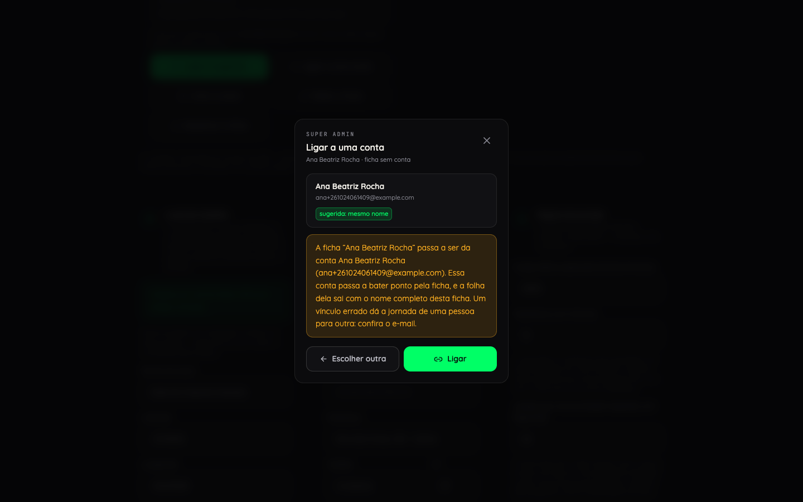

Pronto: a Ana já pode entrar e bater ponto.

## Parte 3. A Rita, do RH, que só administra

### 9. Criar a conta da Rita

A mesma **Nova conta**, agora com **Sem ficha por enquanto**: a Rita fecha a folha, mas não bate ponto.

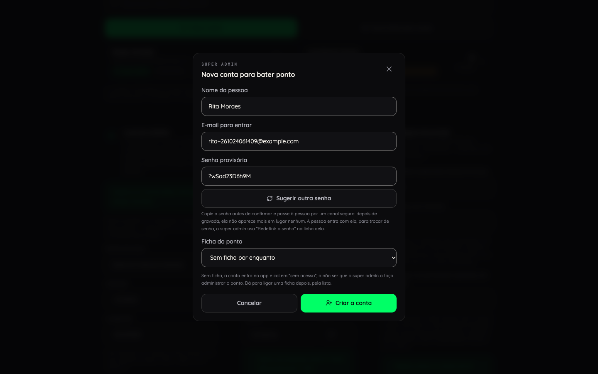

Sozinha, uma conta sem ficha cai em "sem acesso". É o próximo passo que muda isso.

### 10. Conceder a administração

Na linha da Rita, **Conceder admin** abre **Conceder a administração do ponto**. A caixa diz tudo o que a pessoa passa a poder fazer. O campo **Por que esta pessoa? (opcional)** fica gravado com o seu nome e a data. Clique em **Conceder a administração**.

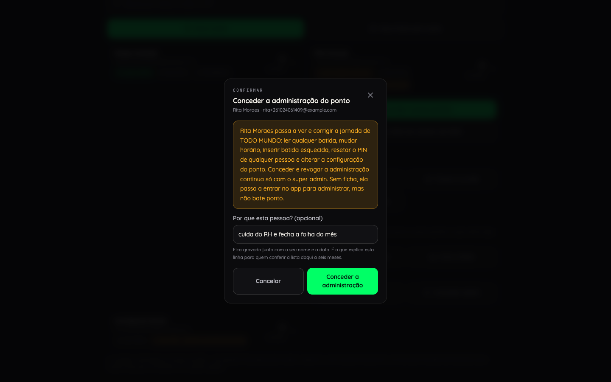

### 11. A lista de pessoas

O topo da lista resume: **3 pessoas · 2 administram o ponto · 1 sem PIN**. O Sérgio aparece como **super admin**. A Rita aparece como **administra o ponto** e **só administra — não bate ponto**, com as ações de conta (**Trocar o nome**, **Trocar o e-mail**, **Redefinir a senha**) e de ficha (**Ligar a uma ficha**, **Criar a ficha**).

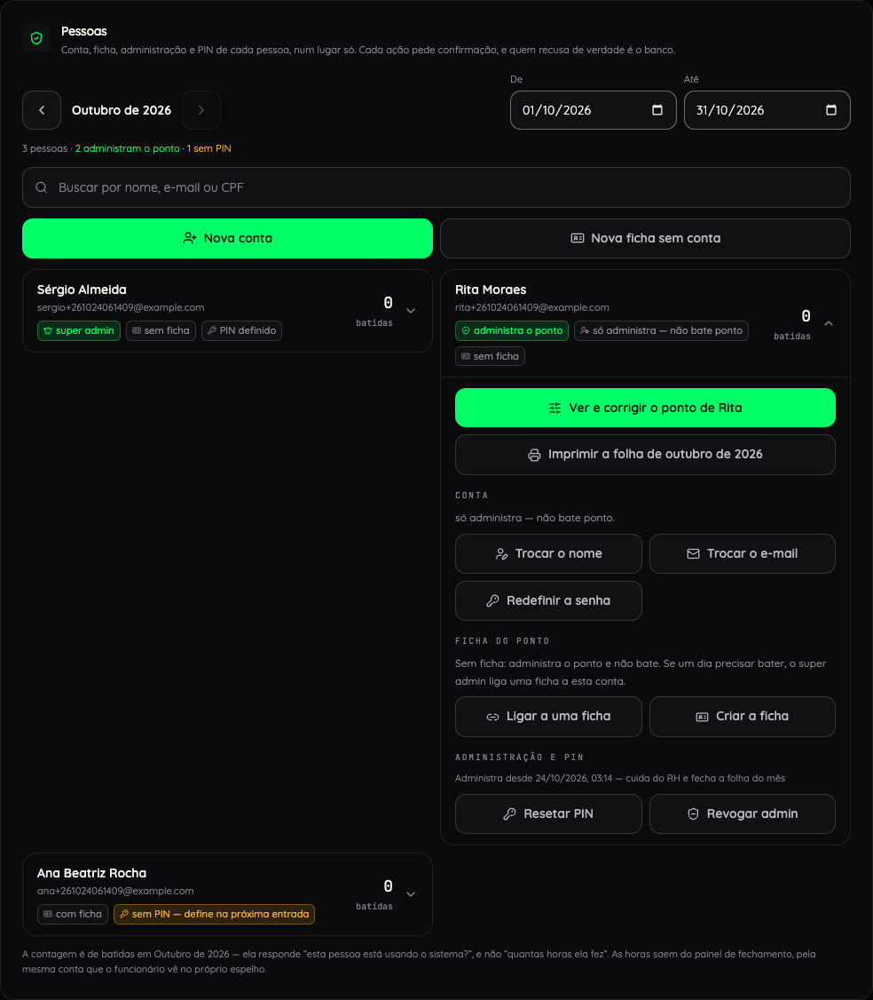

## Parte 4. A Ana bate a primeira entrada, no celular

### 12. Entrar com a senha provisória

A Ana abre o endereço no celular (de preferência já instalado como app: veja [INSTALAR-NO-CELULAR.md](INSTALAR-NO-CELULAR.md)) e entra com o e-mail e a senha provisória.

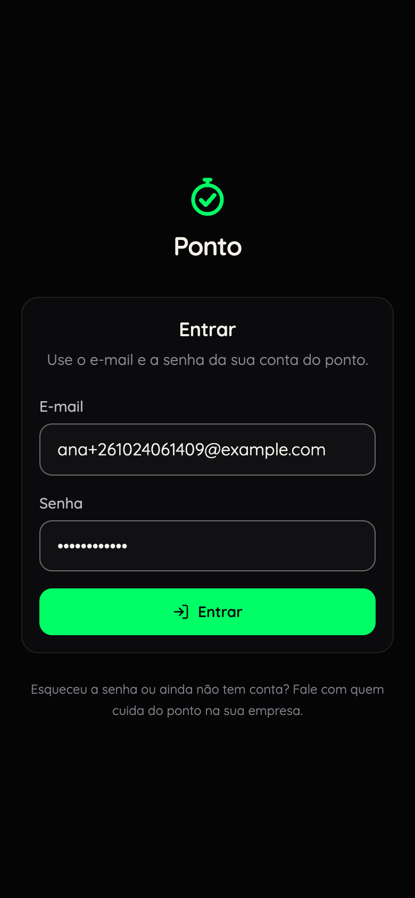

### 13. Criar o PIN

O app pede o PIN, e não pede para trocar a senha.

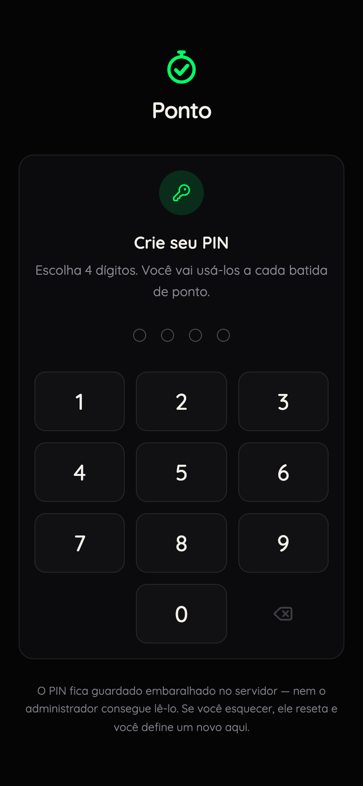

### 14. A tela de bater

A tela chama a Ana pelo nome da ficha, com o cargo em cima. O botão diz qual batida a ordem do dia prevê: **Bater entrada**, "1ª de 4 hoje · selfie, localização e PIN".

### 15. A selfie

**Olhe para a câmera**: a câmera da frente abre, e **Tirar foto** tira a selfie.

### 16. Conferir a foto

**Ficou boa?**: **Usar esta foto** segue; **Refazer** tira outra. Depois disso, o app busca a localização.

### 17. O PIN

**Confirme com seu PIN**: o último passo antes de gravar a batida.

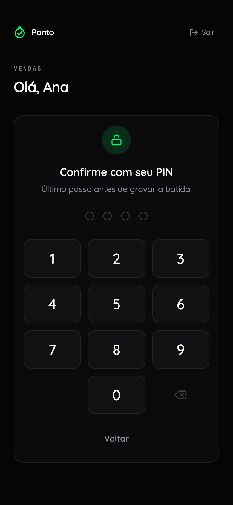

### 18. O comprovante

**Batida registrada**: o tipo (**Entrada · 1ª do dia**), o **horário do servidor**, a selfie e onde ela estava (**No local**, a 11 m do local, com 8 m de precisão). **Concluir** volta ao início.

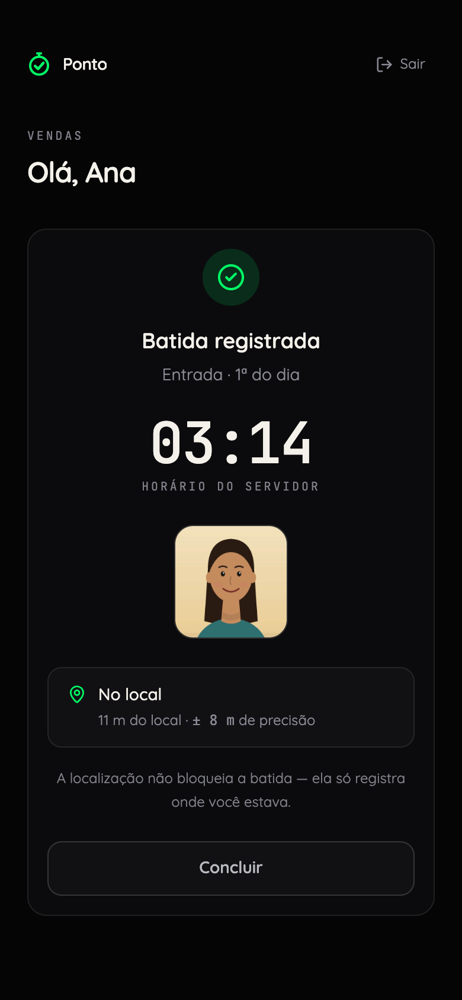

### 19. O espelho do mês

**Ver meu espelho do mês** abre **Seu mês**. O dia de hoje aparece **Em andamento**: as horas dele entram no total quando ela bater a próxima.

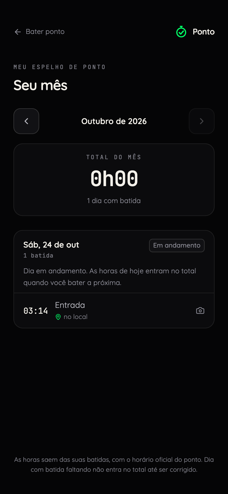

## Parte 5. A Rita confere no computador

### 20. Entrar

A Rita entra com o e-mail e a senha provisória dela.

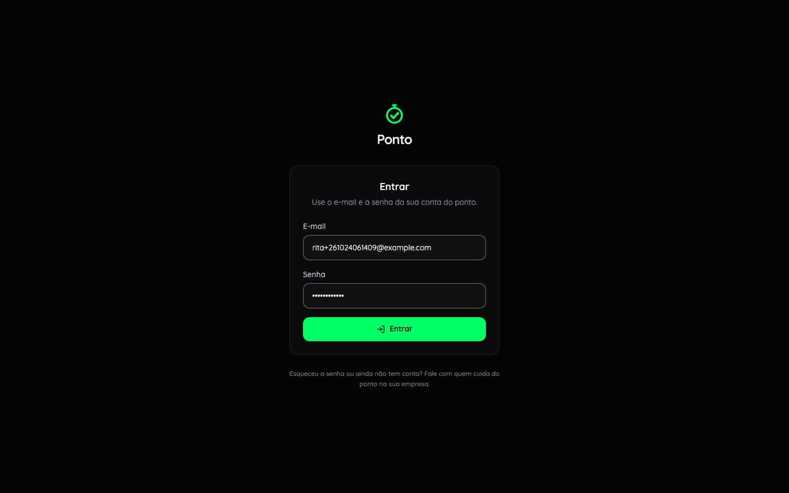

### 21. Criar o PIN

Quem administra também cria o PIN na primeira entrada.

### 22. O painel

Quem só administra cai direto no painel, **Fechamento do período**. A Ana aparece com a entrada de hoje.

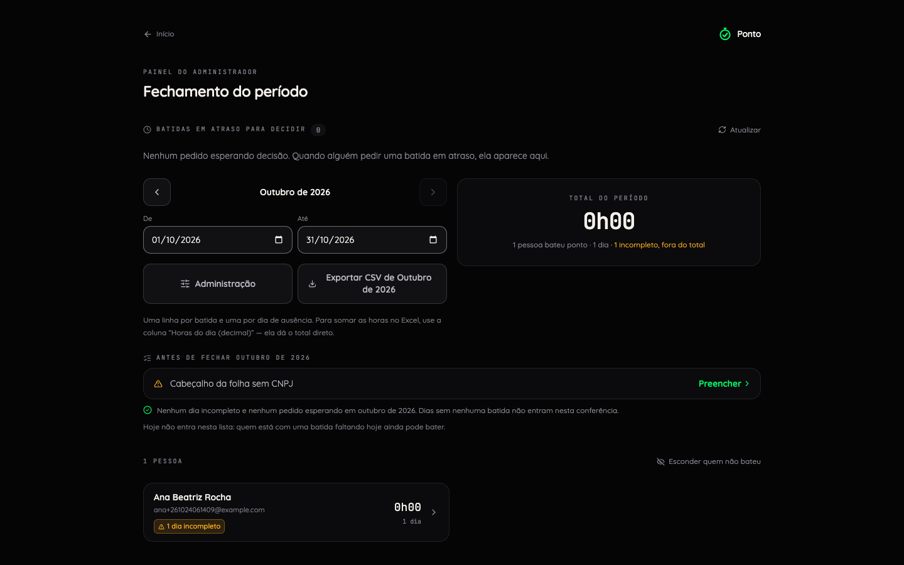

O cartão da Ana marca **1 dia incompleto**, e o total diz "1 incompleto, fora do total". É uma [limitação conhecida](../README.md#limitações-conhecidas-beta): o painel conta o dia de hoje, ainda em andamento, como incompleto. A lista **Antes de fechar** já deixa hoje de fora.

### 23. Os dias da Ana

O cartão abre todos os dias do período até hoje. Cada dia vazio tem **Inserir batida neste dia** e **Lançar falta neste dia**. O dia de hoje aparece **Em andamento**, com a entrada, o botão **Corrigir** e o ícone da câmera.

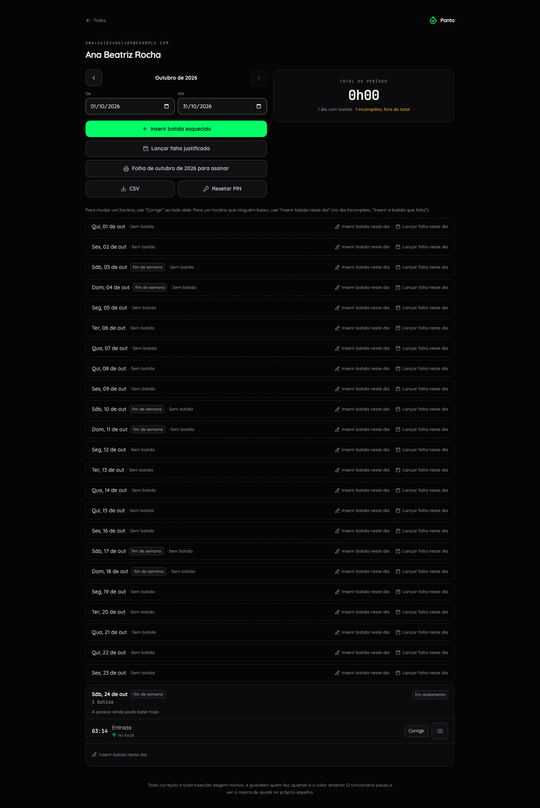

### 24. A selfie da batida

O ícone da câmera abre a selfie. O link da foto vale por 2 minutos e depois deixa de funcionar.

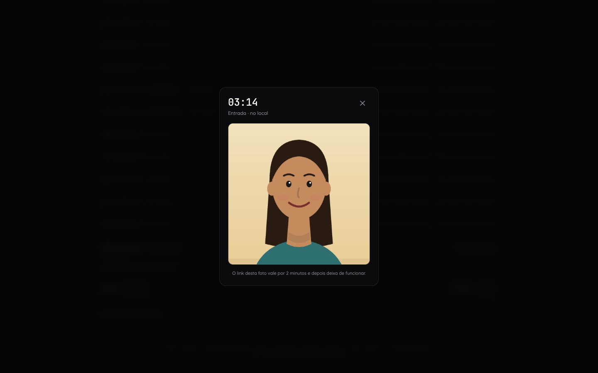

## Depois do cadastro

- **Mandar o app para o time:** [INSTALAR-NO-CELULAR.md](INSTALAR-NO-CELULAR.md) tem mensagens prontas para iPhone e Android.
- **Trocar nome, e-mail ou senha:** na linha da pessoa, com o super admin.
- **Esqueceu o PIN:** **Resetar PIN**, na linha da pessoa ou na tela dela no painel. Na próxima entrada, ela cria um PIN novo.
- **A pessoa saiu da empresa:** preencha o **Desligamento** na ficha (no próprio dia do desligamento ela ainda bate a saída), ou use **Desativar a ficha**. A ficha não se apaga: é dela o nome completo que sai nas folhas já assinadas, e as batidas continuam valendo.
- **Uma conta de setor** (como `vendas@example.com`) que passa de uma pessoa para outra: quem chega ganha conta nova. Veja o porquê na [defesa](DEFESA.md#10-uma-conta-é-uma-pessoa).

O dia a dia de cada papel está no [manual](MANUAL.md).
