# Manual de uso

[Voltar ao README](../README.md)

O dia a dia do ponto, para cada papel. Os nomes dos botões estão **em negrito**, como aparecem no app.

| Papel | Quem é | Onde começa |
| --- | --- | --- |
| [Quem bate ponto](#quem-bate-ponto) | quem tem uma ficha de funcionário ativa ligada à conta | na tela de bater, no celular |
| [Quem administra (o RH)](#quem-administra-o-rh) | quem recebeu a administração do ponto | no painel, no computador |
| [O super admin](#o-super-admin) | quem instalou o ponto (ou quem ele pôs na lista, por SQL) | na administração |

O cadastro do time, passo a passo e com prints, está em [CADASTRO.md](CADASTRO.md).

---

## Quem bate ponto

### A primeira vez

1. Abra o endereço do ponto que a sua empresa mandou. No celular, o app mostra o convite **Instale o app Ponto no celular** (com o nome que a sua empresa deu ao app), com o passo a passo do seu aparelho. Instale antes de entrar: no iPhone, o ícone pede o login de novo. O passo a passo completo está em [INSTALAR-NO-CELULAR.md](INSTALAR-NO-CELULAR.md).

   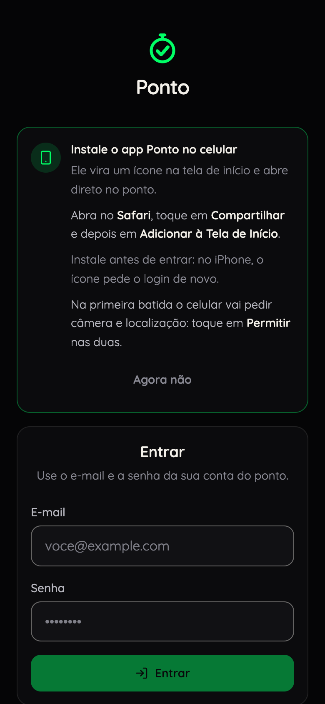

2. Entre com o e-mail e a senha provisória que você recebeu. Login é uma vez só: o celular guarda a sessão.

   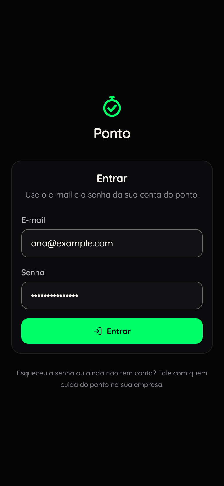

3. Crie o PIN: 4 dígitos, digitados duas vezes. Ele é pedido a cada batida. O PIN fica guardado embaralhado no servidor, e nem quem administra consegue lê-lo.

### Bater o ponto

1. Toque no botão verde. Ele diz qual batida vem agora, pela ordem do dia: **Bater entrada**, **Bater saída para o almoço**, **Bater volta do almoço**, **Bater saída**. Embaixo, "1ª de 4 hoje · selfie, localização e PIN".

   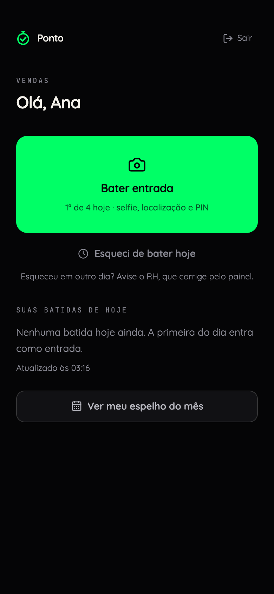

2. **Olhe para a câmera** e toque em **Tirar foto**. Em **Ficou boa?**, toque em **Usar esta foto** (ou em **Refazer**).

   

3. O app busca a sua localização. Em lugar fechado, pode levar até 20 segundos.
4. **Confirme com seu PIN**: os 4 dígitos.

   

5. Pronto: **Batida registrada**, com o tipo, o horário do servidor, a sua foto e onde você estava (**No local** ou **Fora do local**). Toque em **Concluir**.

   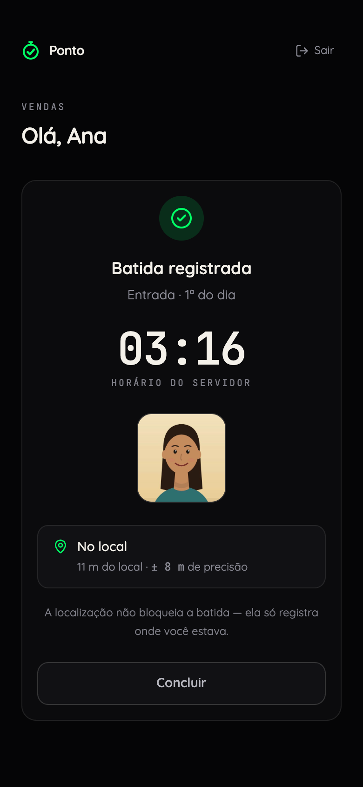

Bom saber:

- **Você não escolhe o tipo da batida.** A 1ª do dia é a entrada, a 2ª é a saída para o almoço, a 3ª é a volta, a 4ª é a saída, e da 5ª em diante é "batida extra".
- **Com o dia completo**, uma batida a mais pede confirmação: **Você já fechou o dia**, com **Voltar** e **Bater mesmo assim**.
- **A distância não bloqueia.** Bater de casa, do cliente ou da rua é permitido: a batida sai marcada "fora do local".
- **O horário é o do servidor**, e não o do celular.
- **Sem internet, a batida não acontece.** O app avisa antes da selfie ("Sem internet...") e o botão fica em "aguardando internet". Nada fica guardado para depois.
- **Duas batidas seguidas**, uma logo depois da outra (dentro de 60 segundos, o padrão): a segunda é recusada como duplicidade, e a primeira continua valendo.
- Se aparecer **Batida não registrada**, nada foi gravado: a mensagem diz o motivo, e **Voltar e tentar de novo** recomeça.

### Quando o GPS não responde

Se o GPS não responder (ou demorar demais), aparece **Não achamos sua localização**. A sua selfie fica guardada:

- **Tentar a localização de novo**: tenta de um jeito mais rápido, sem abrir a câmera de novo. Chegue perto de uma janela ou saia da sala.
- **Bater sem localização**: a batida sai com a sua foto e o PIN, marcada "sem localização". Use quando tentar de novo não resolver.
- **Tirar outra foto** ou **Cancelar**.

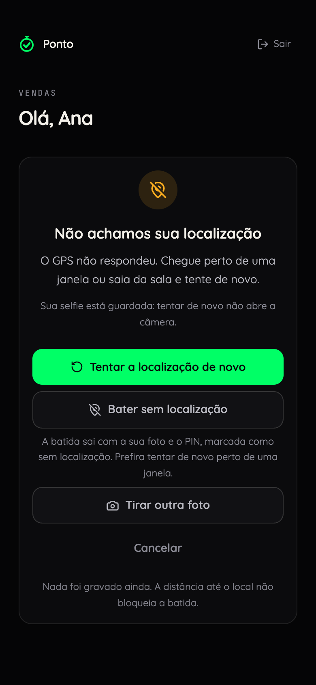

Se você **negou** a permissão de localização (ou de câmera), o app não oferece bater sem ela: ele mostra como liberar no seu aparelho. Veja [INSTALAR-NO-CELULAR.md](INSTALAR-NO-CELULAR.md#4-neguei-sem-querer-como-consertar).

### Esqueci de bater hoje

Chegou e esqueceu de bater? Toque em **Esqueci de bater hoje** (embaixo do botão verde).

1. Em **Registrar batida em atraso**, diga **Que horas você chegou ou saiu e esqueceu de bater?** e escreva o **Motivo** (de 10 a 500 caracteres). A tela mostra as batidas que você já tem hoje e onde o horário escolhido cai entre elas.
2. Depois vêm a selfie, a localização e o PIN, como numa batida.
3. **Pedido enviado**: ele fica "Aguardando aprovação do RH".

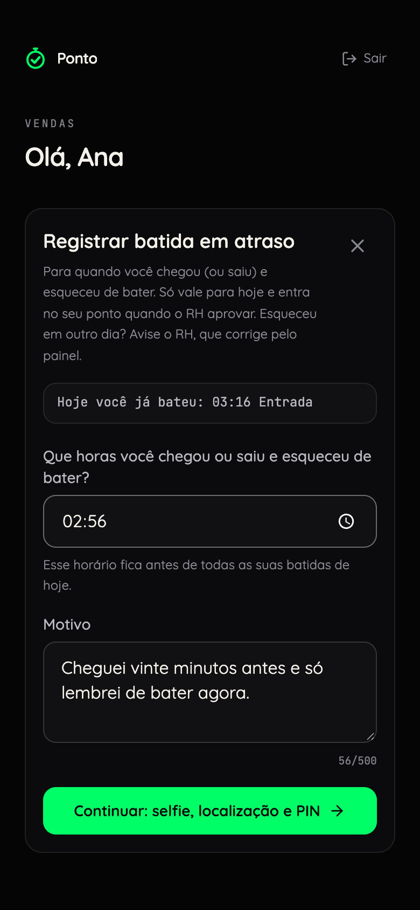

- O pedido vale **só para hoje** e para um horário **antes de agora**.
- Cabem **até 4 pedidos esperando decisão** no mesmo dia. Com quatro na fila, o app pede para esperar o RH decidir os que já estão lá.
- A resposta aparece na lista **Seus pedidos de batida em atraso**. Aprovado, ele vira batida e aparece como "em atraso, aprovada". Recusado, você vê o motivo.
- **Esqueceu em outro dia?** Avise o RH, que corrige pelo painel.

### Conferir o mês

**Ver meu espelho do mês** abre **Seu mês**: o total do mês e cada dia com as batidas.

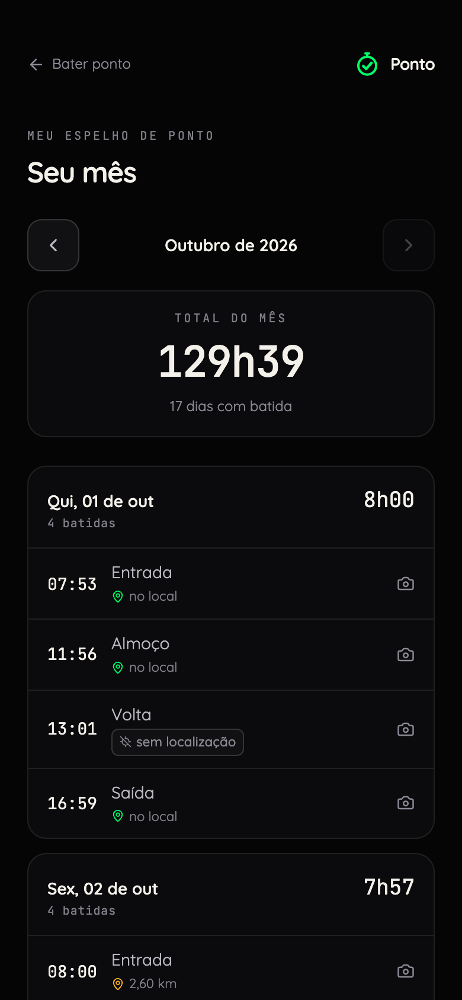

- **Em andamento**: o dia de hoje, ainda aberto. As horas dele entram no total quando você bater a próxima.
- **Dia incompleto**: falta uma batida num dia que já passou, e as horas dele não entram no total. Avise o RH qual horário faltou.
- As marcas ao lado da batida: **ajuste do admin** (o RH corrigiu ou inseriu, com motivo), **em atraso, aprovada por** alguém, **sem localização**, e **no local** ou a distância.
- Toque numa batida para ver a sua selfie.
- As setas trocam o mês. Embaixo ficam as suas ausências e os seus pedidos do mês.

### Problemas comuns

| O que aparece | O que fazer |
| --- | --- |
| "PIN incorreto... Você ainda tem N tentativas." | Confira o PIN. Cinco erros seguidos bloqueiam. |
| **Conta bloqueada** | O bloqueio é da sua conta, não do aparelho: trocar de celular não adianta. O primeiro do dia dura 15 minutos; o segundo, 1 hora; do terceiro em diante, 24 horas. A tela mostra quanto falta. Espere, ou peça ao RH para resetar o seu PIN, o que solta a conta na hora. |
| Esqueci o PIN | O RH reseta. Na próxima entrada, você cria um novo. |
| Esqueci a senha | Fale com quem cuida do ponto na sua empresa. Quem redefine a senha é o super admin, e ele passa uma nova provisória. |
| "Seu acesso ao ponto não está liberado" | A sua conta ainda não tem ficha ativa. Peça a liberação a quem cuida do ponto na sua empresa (quem libera é o super admin) e toque em **Já fui liberado, verificar**. |
| O app pede login toda vez | Não deveria: login é uma vez só. É sinal de aba anônima ou de um atalho estranho. Instale de novo pelo passo a passo. |

---

## Quem administra (o RH)

Depois de entrar, quem administra e não bate ponto cai direto no painel. Quem administra e também bate vê, na tela inicial, **Corrigir ponto** (com o número de pedidos esperando, como "Corrigir ponto · 2 pedidos esperando"), **Painel do administrador** e **Administração**.

### O painel do mês

**Fechamento do período** mostra o mês de todo mundo que é do ponto.

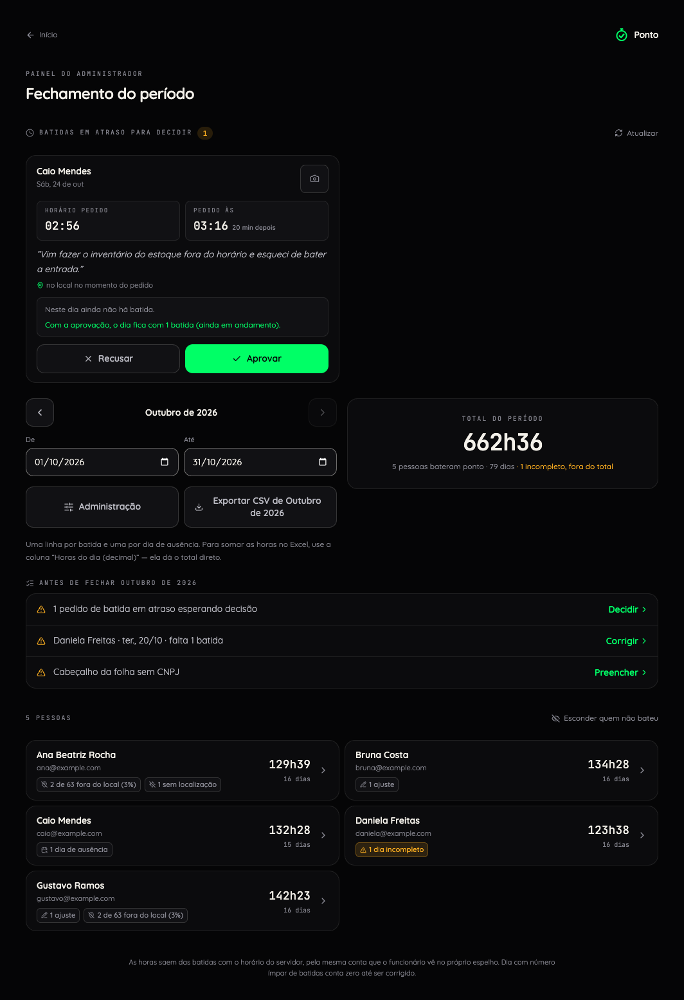

- **O período**: as setas trocam o mês; **De** e **Até** escolhem qualquer intervalo.
- **Total do período**: as horas de todos, quantas pessoas bateram e os dias incompletos (fora do total).
- **Batidas em atraso para decidir**: os pedidos esperando, logo abaixo do título.
- **Antes de fechar** o mês: o que falta resolver, cada item com o link que resolve (**Decidir**, **Corrigir** ou **Preencher**). O dia de hoje não entra nesta lista.
- **O cartão de cada pessoa**: as horas e os dias com batida, e as marcas que pedem atenção: **sem acesso ao ponto**, **sem ficha de RH**, dias incompletos, ajustes, batidas em atraso aprovadas, dias de ausência, a parte das batidas que saiu "fora do local" e as que saíram sem localização.
- **Esconder quem não bateu** deixa só quem tem batida no período.
- **Exportar CSV de (período)** e **Administração** ficam ao lado do total.

### Os dias de uma pessoa

Toque no cartão da pessoa. A tela mostra **todos os dias do período até hoje**, inclusive sábado, domingo e dia vazio.

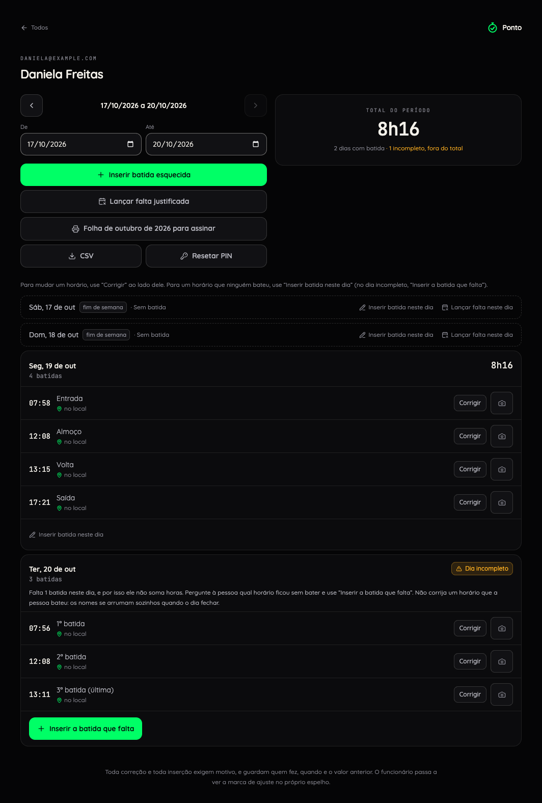

- **Em cada batida:** **Corrigir** e a miniatura da selfie, que abre a foto grande (o link vale por 2 minutos). Enquanto a miniatura não carrega, ou se ela não vier, aparece o ícone da câmera, que abre a foto do mesmo jeito.
- **Em cada dia:** **Inserir batida neste dia** e **Lançar falta neste dia**. No dia com batida faltando, o botão principal é **Inserir a batida que falta**.
- **No topo:** **Inserir batida esquecida**, **Lançar falta justificada**, **Folha de (mês) para assinar**, **CSV** e **Resetar PIN**.
- **Os pedidos** dessa pessoa esperando decisão aparecem acima dos dias.

### Corrigir um horário ou inserir uma batida

**Corrigir** abre **Corrigir horário**; **Inserir batida neste dia** abre **Batida esquecida**.

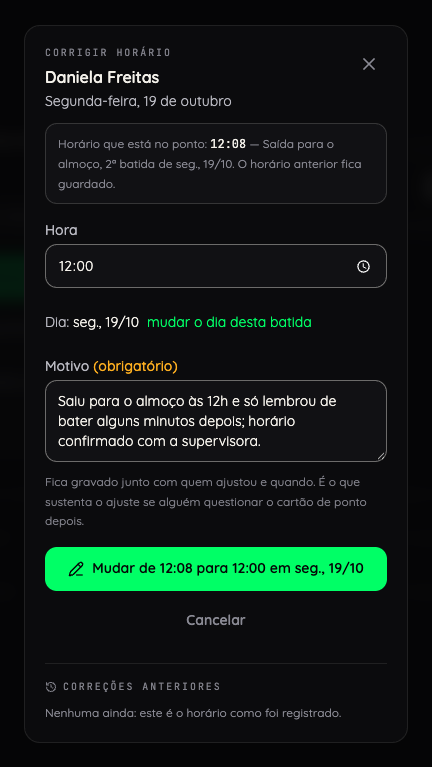

1. Escolha a **Hora** (e o dia, se for o caso). A caixa mostra as batidas que o dia já tem e como ele fica depois.
2. Escreva o **Motivo** (obrigatório). Ele fica guardado com o seu nome.
3. O botão diz exatamente o que vai fazer, como "Mudar de 12:00 para 12:30 em ..." ou "Inserir 13:00 em ...". **Inserir e continuar** grava e deixa a caixa aberta para a próxima.

- **Ninguém corrige nem insere a própria batida**, nem o super admin. Na sua própria página do painel, os botões aparecem, mas o banco recusa e o app explica: peça a outra pessoa que administra o ponto, ou ao super admin.
- **Batida inserida não se apaga.** Confira o dia e a hora antes de gravar.
- A batida inserida nasce sem foto e sem localização. O sistema reorganiza entrada, almoço, volta e saída pelo horário, então dá para inserir a que faltou em qualquer ponto do dia.
- Toda correção guarda o valor anterior numa trilha permanente, e a pessoa vê a marca "ajuste do admin" no espelho dela.
- O banco recusa horário no futuro.
- Se a pessoa já pediu aquela batida, a caixa avisa: aprove o pedido em vez de inserir.

### Decidir um pedido de batida esquecida

Cada pedido mostra quem pediu, o horário que a pessoa diz, a hora em que ela pediu de verdade, o motivo, a selfie, onde ela estava e como o dia fica com a aprovação.

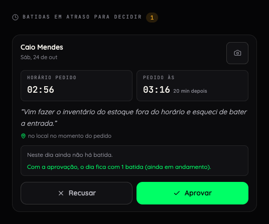

- **Aprovar**: a batida entra no ponto e o dia se reorganiza pelo relógio. A observação é opcional.
- **Recusar**: o motivo é obrigatório, e a pessoa vai ler esse texto. O pedido continua guardado.
- Quem pediu não decide o próprio pedido: outra pessoa que administra decide.

### Lançar falta justificada

**Lançar falta justificada** (no topo) ou **Lançar falta neste dia** (no dia) abre a caixa:

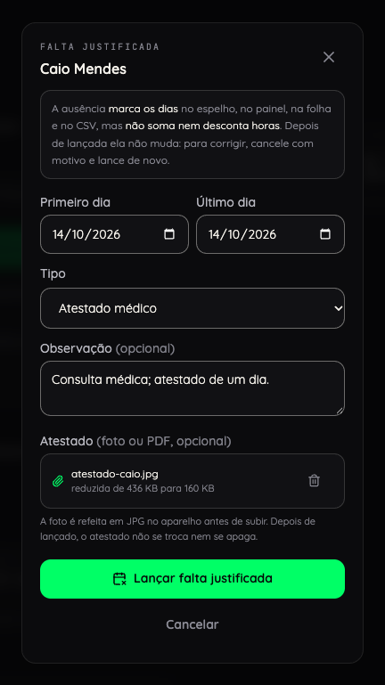

1. **Primeiro dia** e **Último dia** (até 120 dias de uma vez).
2. **Tipo**: **Atestado médico**, **Falta justificada** ou **Outro motivo** (este pede observação).
3. **Atestado**: foto ou PDF, opcional. A foto é refeita em JPG no próprio aparelho antes de subir: em geral fica bem menor, e sai sem os dados que a câmera grava no arquivo, como o lugar onde ela foi tirada. O PDF vai como veio, e a foto que o navegador não consegue abrir (HEIC, fora do Safari) também, com esses dados.
4. **Lançar falta justificada**.

- A ausência marca os dias no espelho, no painel, na folha e no CSV, mas **não soma nem desconta horas**.
- Depois de lançada, ela não muda. Para corrigir, toque em **Cancelar** na lista de ausências do período, escreva o motivo, confirme em **Cancelar a ausência** e lance de novo.
- O atestado não se anexa depois: se ele chegar mais tarde, cancele a ausência e lance de novo, com ele.

### Fechar o mês: a folha e o CSV

**A folha para assinar.** Na tela da pessoa, **Folha de (mês) para assinar** (ou **Imprimir a folha de (mês)**, na lista de pessoas) abre a folha mensal: o cabeçalho com os dados da empresa, o nome completo da pessoa (o da ficha) e o e-mail da conta, um dia por linha com os horários e o total, a legenda das marcas e as linhas de assinatura do funcionário e do responsável. **Imprimir ou salvar em PDF** abre a caixa de impressão do navegador.

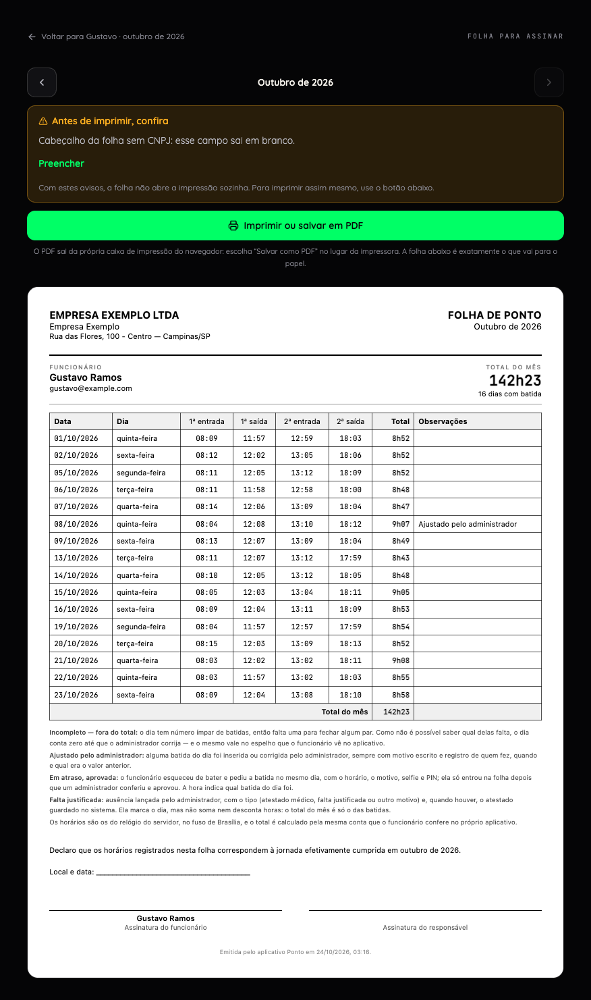

Se houver dia incompleto, pedido esperando ou cabeçalho incompleto, a folha mostra **Antes de imprimir, confira**, com os links que resolvem, e não abre a impressão sozinha.

**O CSV.** **Exportar CSV de (período)** (no painel, de todo mundo) ou **CSV** (na tela da pessoa) baixa uma planilha com uma linha por batida e uma por dia de ausência. Para somar as horas no Excel, use a coluna "Horas do dia (decimal)": ela dá o total direto.

### Resetar o PIN

**Resetar PIN**, na tela da pessoa ou na linha dela em **Pessoas**. Na próxima entrada, ela cria um PIN novo. O bloqueio por tentativas erradas, se houver, também sai na hora, e a conta dos bloqueios do dia volta a zero.

### A administração

**Administração** abre com seis cartões, cada um com o que espera por você: **Batidas em atraso**, **Pessoas**, **Ausências**, **Local de trabalho**, **Dados da empresa** e **Regras de jornada**.

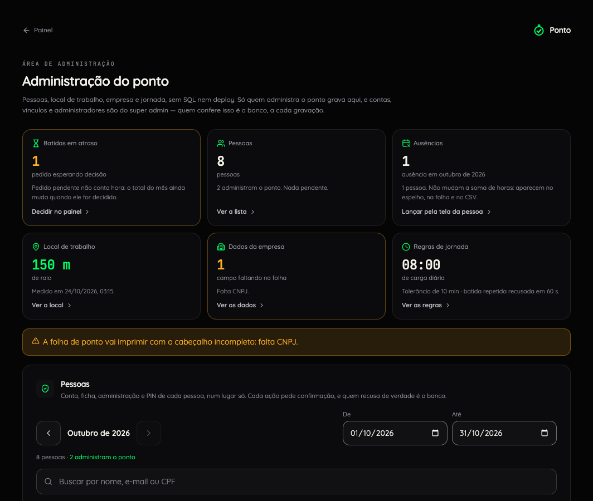

**Pessoas.** Uma lista só, uma linha por pessoa: a conta, a ficha, a administração e o PIN. **Buscar por nome, e-mail ou CPF** filtra. Quem administra (sem ser super admin) pode:

- abrir **Ver e corrigir o ponto de (nome)** e **Imprimir a folha de (mês)**;
- **Resetar PIN**;
- cuidar das fichas: **Nova ficha sem conta**, **Editar a ficha** e **Desativar a ficha**.

Criar a conta, trocar e-mail, redefinir senha e ligar a ficha à conta são tarefas do super admin.

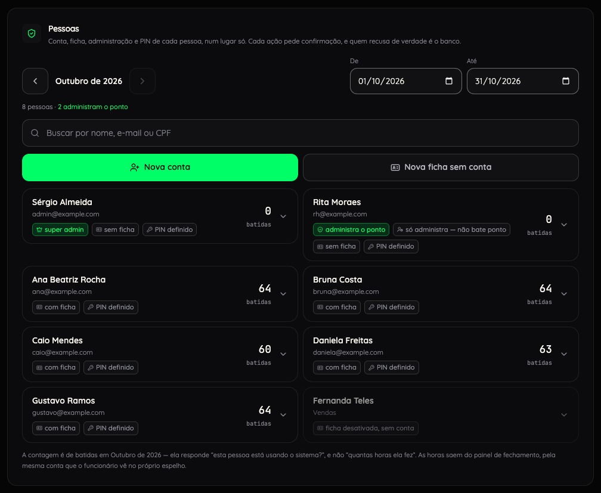

**Local de trabalho.** O lugar que decide se a batida é "no local" ou "fora do local".

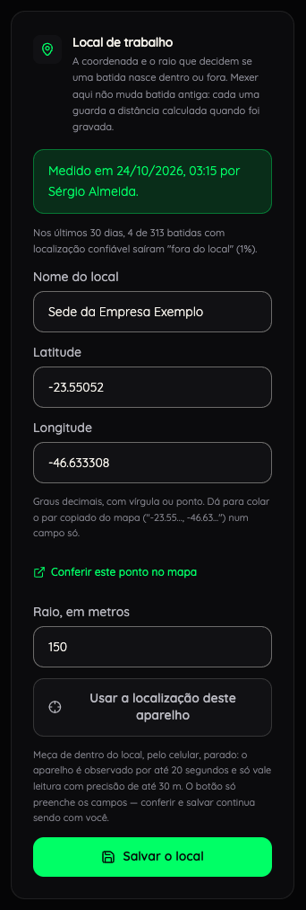

- **Nome do local**, **Latitude**, **Longitude** (graus decimais, com vírgula ou ponto; dá para colar o par copiado do mapa num campo só) e **Raio, em metros**.
- **Usar a localização deste aparelho** mede onde o aparelho está: use o celular, parado, de dentro do local. Um notebook em casa mediria a casa.
- **Conferir este ponto no mapa** abre o mapa para conferir.
- **Salvar o local**. Mudar o local não muda batida antiga: cada uma guarda a distância calculada quando foi gravada.

**Dados da empresa.** Razão social, nome de fantasia, CNPJ, endereço, cidade e UF: o cabeçalho da folha. Campo em branco imprime em branco.

**Regras de jornada.**

- **Carga diária esperada** e **Tolerância**: ficam guardadas e aparecem na administração, mas hoje ainda não entram em conta nenhuma (não há saldo nem hora extra).
- **Janela que recusa batida repetida**: entre 10 e 900 segundos (padrão: 60). Vale já na próxima batida.

---

## O super admin

O super admin faz tudo o que quem administra faz e mais o que mexe em contas e em acesso. Ele nasce na instalação, por SQL ([INSTALAR.md, passo 5](INSTALAR.md#5-criar-o-primeiro-super-admin)).

### As contas

- **Nova conta**: **Nome da pessoa**, **E-mail para entrar**, **Senha provisória** (com **Sugerir outra senha**) e **Ficha do ponto** (uma ficha que já existe, **Criar uma ficha nova com este nome** ou **Sem ficha por enquanto**). Clique em **Criar a conta**.
- A senha provisória aparece **uma vez**. Copie antes de confirmar e passe à pessoa por um canal seguro.
- **Trocar o nome**, **Trocar o e-mail** e **Redefinir a senha** ficam na linha da pessoa. Redefinir gera uma nova senha provisória: é assim que alguém "troca de senha".
- Cada uma dessas ações fica numa trilha (quem, o quê e quando), sem a senha.

### As fichas e o acesso

- **Ligar a uma ficha** (na linha da conta) ou **Ligar a uma conta** (na linha da ficha). Quando o nome combina, aparece **Ligar à sugerida**. Confira o e-mail: um vínculo errado dá a jornada de uma pessoa para outra.
- **Desligar da conta** tira a ficha da conta: na próxima abertura do app, a pessoa deixa de bater ponto por ela. A ficha continua existindo, e as batidas antigas não mudam.
- **Reativar a ficha** de quem está ligado a uma conta devolve o ponto a essa conta, e por isso é só do super admin.

### Quem administra

- **Conceder admin**, com **Por que esta pessoa? (opcional)**, e **Revogar admin**.
- O banco não deixa o ponto ficar sem nenhum administrador depois que alguém foi nomeado: para tirar o último, conceda antes a outra pessoa.

### O que nem o super admin faz pelo app

- Mudar a lista de super admins: só por SQL, no painel do Supabase.
- Trocar o e-mail de uma conta de super admin: só pelo painel do Supabase.
- Mexer na conta de outro super admin.
- Corrigir ou inserir a própria batida, ou decidir o próprio pedido de batida esquecida: isso é com outra pessoa que administra.
- Apagar uma batida: ela se corrige, com motivo e trilha.

Sem ficha ativa ligada à conta, as batidas do super admin servem só para teste e não entram na folha de ninguém do time. Com uma ficha ativa ligada, ele bate pela ficha, como qualquer pessoa.

O caminho completo do cadastro, com um print por passo, está em [CADASTRO.md](CADASTRO.md).
